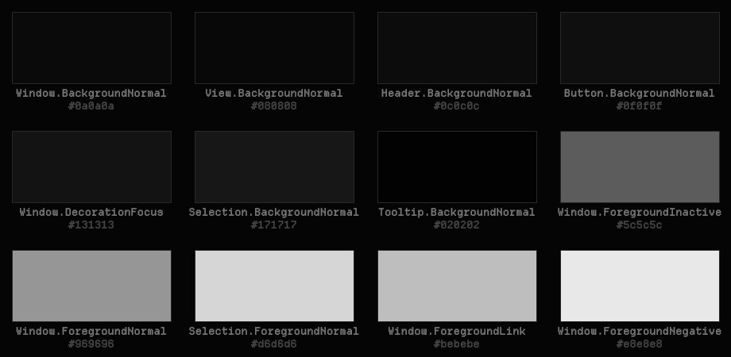

# Redacted — Colour Scheme

A monochrome-black KDE colour scheme. Every role is a neutral grey, the accent sits seven levels above the surface, and a selection reads by its text brightening.



Redacted is a monochrome-black look for KDE Plasma 6 about obfuscation and censorship. Every colour is a neutral grey, and the accents sit only a few levels above black: almost imperceptible, but just perceptible. The motifs are static, mosaic pixelation, black censor bars and a dissociated double.

## Features

- Surfaces between `#020202` and `#0f0f0f`. Window `#0a0a0a`, views `#080808`, headers `#0c0c0c`.
- The focus and hover accent is `#131313`: almost imperceptible, but just perceptible.
- Text is `#969696`. Selected and hovered text brightens to `#d6d6d6`, and that is how a selection reads.
- Negative, neutral and positive are brightness steps, not hues, so nothing ever picks up a tint.
- Titlebar colours are set too, for Breeze decorations.


## Requirements

Plasma 5 or 6.

## Install

```bash
git clone https://github.com/numbpill3d/redacted-colors
cd redacted-colors && ./install.sh
```

Or from the KDE Store: System Settings → Colors & Themes → Colors → Install from File, or copy it to `~/.local/share/color-schemes/`.

## The rest of the suite

| piece | repo |
|---|---|
| Global theme + splash screen | [redacted-global](https://github.com/numbpill3d/redacted-global) |
| Plasma style (panel, popups) | [redacted-plasma](https://github.com/numbpill3d/redacted-plasma) |
| Aurorae window decoration | [redacted-aurorae](https://github.com/numbpill3d/redacted-aurorae) |
| Kvantum widget style | [redacted-kvantum](https://github.com/numbpill3d/redacted-kvantum) |
| Icon theme | [redacted-icons](https://github.com/numbpill3d/redacted-icons) |
| Konsole + kitty colours | [redacted-konsole](https://github.com/numbpill3d/redacted-konsole) |
| SDDM login | [redacted-sddm](https://github.com/numbpill3d/redacted-sddm) |
| Plymouth boot splash | [redacted-plymouth](https://github.com/numbpill3d/redacted-plymouth) |
| Animated wallpaper (desktop + lock) | [redacted-wallpaper](https://github.com/numbpill3d/redacted-wallpaper) |
| Still wallpaper (1080p–4K) | [redacted-image-wallpaper](https://github.com/numbpill3d/redacted-image-wallpaper) |
| KWin open/close effect | [redacted-censor](https://github.com/numbpill3d/redacted-censor) |
| KWin script: active window under review | [redacted-static](https://github.com/numbpill3d/redacted-static) |
| Clock plasmoid | [redacted-clock](https://github.com/numbpill3d/redacted-clock) |

Everything at once, with the generators: [redacted-kde](https://github.com/numbpill3d/redacted-kde).

## Tags

`redacted` `kde` `plasma6` `dark` `black` `monochrome` `grayscale` `minimal` `censored` `glitch` `static` `pixel` `color-scheme` `colour-scheme` `dark-theme` `kdeglobals` `black-theme`

## Credits and licence

By splicer scorn (voidrane). GPL-3.0-or-later.
